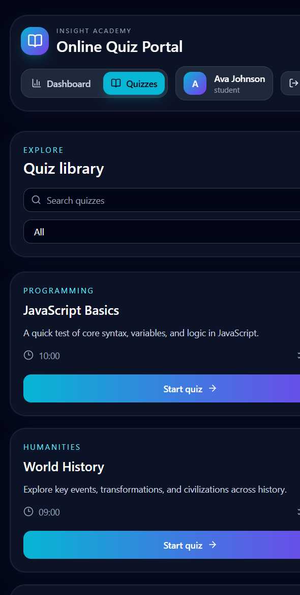
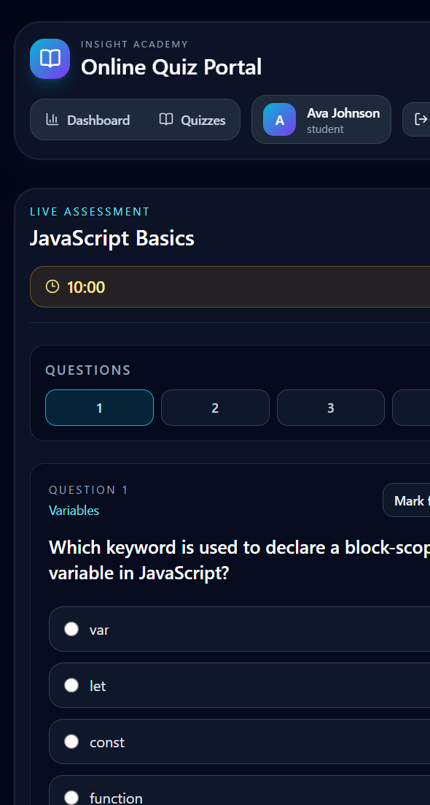
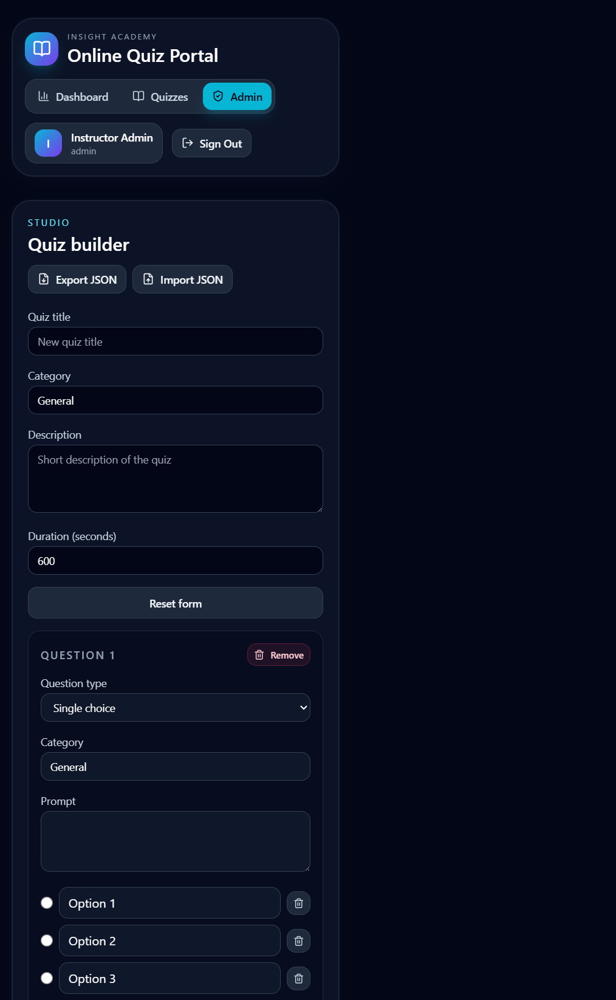

# Online Quiz Portal — Project Report

## 1. Abstract

The Online Quiz Portal is a responsive, browser-based examination and learning application built with React. Students can browse quizzes, take timed assessments, and review their scores and answers. An administrator can create, edit, and remove quizzes, as well as import and export quiz data in JSON format. Quiz data, user profiles, and attempts are persisted in the browser's `localStorage`, so the project can be demonstrated without a server or database.

The application includes a dashboard for performance summaries and category insights, and a print-friendly result/certificate view. Authentication and the supplied student/admin accounts are intended for demonstration only; they are not backed by a secure authentication service.

## 2. Objectives

- Provide a simple portal for students to discover and complete online quizzes.
- Support timed assessments with single-choice, multiple-choice, and true/false questions.
- Calculate scores and show a per-question answer review after submission.
- Give students a dashboard with attempt history and performance summaries.
- Provide an admin workspace for quiz creation, editing, and deletion.
- Allow quiz collections to be imported from and exported to JSON.
- Persist application data between visits using browser storage.
- Deliver a responsive interface that works across common screen sizes.
- Provide a print-ready result/certificate layout.

## 3. Table of Contents

1. [Abstract](#1-abstract)
2. [Objectives](#2-objectives)
3. [Table of Contents](#3-table-of-contents)
4. [Project Architecture](#4-project-architecture)
5. [Technology Stack](#5-technology-stack)
6. [Outcome and Learning Experience](#6-outcome-and-learning-experience)
7. [Project Screenshots](#7-project-screenshots)
8. [Problems Faced During the Project](#8-problems-faced-during-the-project)
9. [Conclusion](#9-conclusion)

## 4. Project Architecture

The project is a client-side single-page application. React components render the screens, React Router maps URLs to workflows, and a storage service reads and writes application data to `localStorage`.

```text
┌──────────────────────────────────────────────┐
│                User (Browser)                │
└──────────────────────┬───────────────────────┘
                       │
                       ▼
┌──────────────────────────────────────────────┐
│ React UI (src/App.jsx)                       │
│ Login / Signup · Dashboard · Quiz Catalog    │
│ Timed Assessment · Results · Admin Studio    │
└──────────────────────┬───────────────────────┘
                       │
          ┌────────────┴─────────────┐
          ▼                          ▼
┌──────────────────────┐   ┌────────────────────────┐
│ React Router         │   │ Application logic       │
│ /login /dashboard    │   │ Auth flow, timer,       │
│ /quizzes /quiz/:id   │   │ scoring, analytics,     │
│ /results/:attemptId  │   │ quiz import/export      │
│ /admin               │   └────────────┬───────────┘
└──────────────────────┘                │
                                        ▼
                           ┌────────────────────────┐
                           │ storageService.js      │
                           │ Seed, normalize,       │
                           │ migrate, persist       │
                           └────────────┬───────────┘
                                        │
                                        ▼
                           ┌────────────────────────┐
                           │ Browser localStorage   │
                           │ Quizzes · Users        │
                           │ Profiles · Attempts    │
                           └────────────────────────┘
```

### Main data flow

1. On startup, the app initializes or loads quiz, user, profile, and attempt data through `storageService.js`.
2. The user signs in with a demo account or creates a student account. The selected user is stored locally.
3. A student chooses a quiz from the catalog. During the attempt, answers and the countdown timer are managed in the React UI.
4. On submission or timer expiry, answers are checked against the quiz key, a score and answer breakdown are created, and the attempt is saved locally.
5. The dashboard reads saved attempts to calculate performance summaries. The results view can be printed using the browser's print dialog.
6. An administrator manages quiz content in the admin studio. Quiz collections can also be transferred using JSON import/export.

## 5. Technology Stack

| Technology | Use in the project |
|---|---|
| React 19 | Component-based user interface and interactive application state |
| Vite 8 | Development server and production build tooling |
| React Router 7 | Client-side navigation between login, dashboard, quiz, results, and admin screens |
| Tailwind CSS 3 | Utility-first responsive styling |
| PostCSS and Autoprefixer | CSS processing and browser vendor-prefix support |
| Lucide React | Interface icons |
| Browser `localStorage` | Client-side persistence for quizzes, demo users, profiles, and attempts |
| JSON and browser File APIs | Quiz collection import and export |
| Browser print styles | Printable result/certificate output |

**Architecture note:** This is a front-end-only demonstration. It has no server API or database. Data is stored per browser profile, and the included authentication flow is not suitable for real accounts or sensitive assessments.

## 6. Outcome and Learning Experience

The project brings together a working quiz catalogue, timed assessment flow, results review, student dashboard, and admin quiz editor. The following comparison can be used as a 10-point learning reflection:

| # | Before starting | After completing |
|---:|---|---|
| 1 | I had limited experience structuring a multi-screen React application. | I can organize screens into reusable React components and connect them through routes. |
| 2 | Managing interface state across several workflows was unfamiliar. | I practiced using React state and effects for forms, navigation-related flows, answers, and timers. |
| 3 | I had not built an assessment flow with multiple answer formats. | I learned to handle single-choice, multiple-choice, and true/false questions and compare selections with an answer key. |
| 4 | Timed activities and automatic submission were new challenges. | I learned to update a countdown with an interval and submit an attempt when time expires. |
| 5 | Saving app data between browser visits was unfamiliar. | I learned to serialize and restore app data with `localStorage` and to initialize demo data. |
| 6 | I had limited experience designing admin content tools. | I built form flows for adding, editing, and deleting quizzes and questions. |
| 7 | Moving structured data between an app and a file was new. | I practiced parsing JSON imports and generating downloadable JSON exports. |
| 8 | I had not used quiz results as a source for dashboard insights. | I learned to derive score summaries, category insights, and grade distributions from saved attempts. |
| 9 | Responsive layout and print presentation were separate concerns. | I applied responsive utility styling and print-specific CSS for the result/certificate view. |
| 10 | I had not considered the limits of a front-end-only authentication model. | I can explain why local demo accounts and browser storage do not provide production-grade security or shared data. |

## 7. Project Screenshots

Screenshots below were captured from the running project. The image files are included in the [`report_screenshots/`](./report_screenshots/) folder.

### 7.1 Student dashboard

The dashboard displays attempt count, average and best scores, analytics areas, and recent attempts.


### 7.2 Quiz catalogue

Students can browse available quizzes, search the catalogue, and filter by category.



### 7.3 Timed assessment

The assessment screen shows the countdown, question navigation, answer controls, and submission action.



### 7.4 Admin quiz studio

The admin screen provides quiz authoring controls and a library of existing quizzes, along with JSON import/export.



## 8. Problems Faced During the Project

The main technical challenges addressed by the project include:

1. **Persisting structured data without a backend:** The app uses a dedicated storage helper to read and write local data, seed sample content, normalize record collections, and migrate older stored state.
2. **Keeping quiz authoring flexible:** Quiz questions need different answer controls and option behavior. The editor supports single-choice, multiple-choice, and true/false formats and maintains the selected correct answers.
3. **Calculating scores consistently:** Multiple-choice answers must match the full correct-answer set; a partially correct selection should not be counted as a fully correct question.
4. **Managing the countdown lifecycle:** The timer must update while an assessment is open, stop when the component unmounts, and trigger submission when it reaches zero.
5. **Reflecting assessment data in analytics:** Dashboard values must be derived from the current user's attempts and should display useful empty states before the first attempt.
6. **Validating imported quiz files:** JSON input may be malformed or incomplete, so the import flow parses and normalizes quiz data and displays an error for invalid input.
7. **Providing a usable print view:** The dark application theme needs print-specific styles so that exported results/certificates are readable on paper.
8. **Working within client-only security limits:** Demo authentication and `localStorage` are convenient for a local project, but they cannot safely protect credentials or enforce authorization for a deployed examination system.

## 9. Conclusion

The Online Quiz Portal demonstrates an end-to-end client-side assessment workflow, from quiz management and discovery to timed answering, score review, and basic performance analytics. It also provides experience with React component design, browser persistence, routing, JSON file handling, and responsive UI development. For real-world use, the next step would be to add a secure backend for authentication, authorization, quiz delivery, and persistent shared records.
